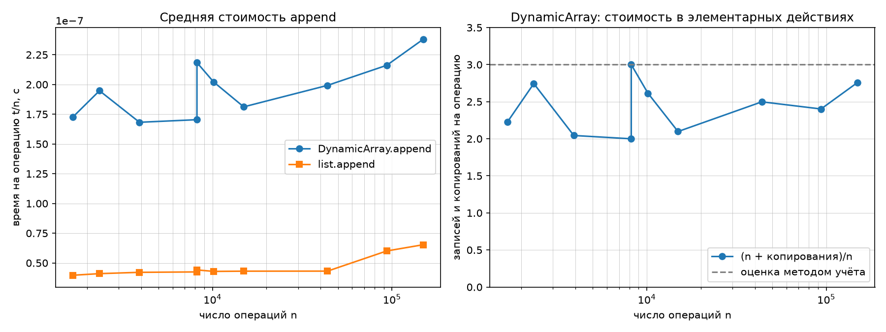
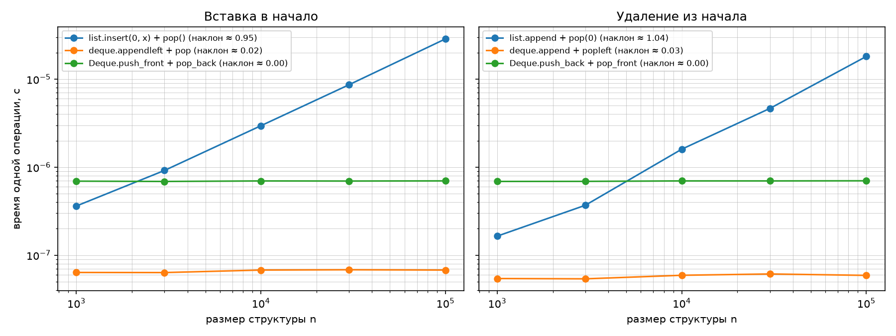

# Отчёт по ЛР 2. Рекурсивные функции, динамический массив, стек и дек

## 1. Вариант и окружение

- **Вариант:** 24, seed = 30 + 24 = **54**.
- **Данные:** `python scripts/generate_data.py --variant 24 --only ops` — по 100 000 операций для стека и дека, 10 размеров серий `append` (включая пару 8192 / 8193 на границе роста ёмкости).
- **Окружение:** Python 3.14.8, matplotlib 3.11.2, numpy 2.5.4; Linux 7.2.11, AMD Ryzen 7 5700U.
- **Запуск:** `python lab02-recursion-structures-starter.py --variant 24 --data ../../data/generated --out .`

Все замеры — медиана 5 повторов после прогрева, `time.perf_counter()`. Абсолютные времена зависят от машины; важны порядок роста и сравнение реализаций между собой на одних и тех же данных.

## 2. Рекурсивные функции

### 2.1. Факториал

```
T(n) = T(n - 1) + O(1),  T(0) = 1  =>  T(n) = O(n)
```

Время — Θ(n), глубина стека вызовов и дополнительная память — O(n). Проверено на n = 0..20 сверкой с `math.factorial`.

### 2.2. Числа Фибоначчи: наивная рекурсия и мемоизация

Наивная рекурсия повторно вычисляет одни и те же подзадачи:

```
T(n) = T(n - 1) + T(n - 2) + O(1)  =>  T(n) = Θ(φ^n),  φ = (1 + √5) / 2 ≈ 1.618
```

Число вызовов равно числу узлов дерева рекурсии: **C(n) = 2·F(n + 1) − 1**.

Мемоизация сохраняет каждое вычисленное значение в словаре, поэтому каждая подзадача 0..n решается один раз: **O(n)** по времени и O(n) по памяти. Второй рекурсивный вызов на каждом уровне попадает в `memo`, поэтому при n ≥ 2 число вызовов **C(n) = 2n − 1**.

| n | F(n) | вызовов `fib_naive` | 2·F(n+1) − 1 | вызовов `fib_memo` | 2n − 1 |
|---:|---:|---:|---:|---:|---:|
| 5 | 5 | 15 | 15 | 9 | 9 |
| 10 | 55 | 177 | 177 | 19 | 19 |
| 15 | 610 | 1 973 | 1 973 | 29 | 29 |
| 20 | 6 765 | 21 891 | 21 891 | 39 | 39 |
| 25 | 75 025 | 242 785 | 242 785 | 49 | 49 |
| 30 | 832 040 | 2 692 537 | 2 692 537 | 59 | 59 |

Формулы совпали со счётчиками во всех строках. При n = 30 мемоизация делает 59 вызовов вместо 2 692 537 — выигрыш примерно в 45 600 раз; с ростом n отношение растёт экспоненциально, что и подтверждает Θ(φ^n) против O(n).

### 2.3. Ханойские башни

```
T(n) = 2·T(n − 1) + 1,  T(0) = 0  =>  T(n) = 2^n − 1
```

Время — Θ(2^n), глубина рекурсии — O(n). `self_check` проигрывает записанные ходы на модели стержней и проверяет: каждый ход — пара разных стержней, диск не кладётся на меньший, все n дисков оказываются на целевом стержне, число ходов равно 2^n − 1 (проверено для n = 0, 1, 2, 3, 6, 7, в том числе для стержней `X`, `Y`, `Z`, `P`, `Q`, `R`).

## 3. DynamicArray

### 3.1. Устройство и инварианты

Буфер — список фиксированной длины, «сырая» память; `list.append/insert/pop` для буфера не используются.

- `0 <= size <= capacity`, причём `len(_buffer) == capacity`;
- `capacity` — степень двойки, начальное значение 4, рост ровно ×2;
- элементы хранятся в ячейках `0..size-1`, ячейки `size..capacity-1` равны `None`;
- `get`/`set` допустимы только для `0 <= index < size`, иначе `IndexError` (отрицательные индексы тоже отвергаются);
- `copies` — суммарное число перенесённых элементов при смене буфера.

После n добавлений:

```
capacity(n) = max(4, 2^ceil(log2 n))
copies(n)   = max(0, 2^ceil(log2 n) − 4)
```

Например, n = 8192: capacity = 8192, copies = 8188; n = 8193: capacity = 16384, copies = 16380. Обе формулы проверяются в `check_own_invariants` на каждом из 300 последовательных `append`.

Сжатие буфера не реализовано: оно необязательно, а без него ёмкость не «дрожит» на границе. Сжатие вдвое при заполнении на ½ дало бы Θ(n) при чередовании `append`/`pop`; безопасный вариант — сжатие при заполнении не более ¼.

### 3.2. Амортизированный анализ `append` методом учёта

Назначим каждой операции `append` **3 кредита**: 1 — запись элемента, 2 — «про запас» на будущее копирование. Когда буфер ёмкости c заполнен, в нём c элементов, и они накопили 2c кредитов. Расширение копирует c элементов и стоит c кредитов, то есть накопленного запаса хватает с двукратным избытком. Следовательно, суммарная стоимость n добавлений не превышает 3n, а средняя стоимость одной операции — **O(1)**; худший случай отдельной операции — O(n).

Отсюда `(n + copies) / n < 3`. Наблюдаемые значения:

| n | t/n, DynamicArray, с | t/n, list, с | copies | (n + copies)/n |
|---:|---:|---:|---:|---:|
| 1 670 | 1.73e−07 | 3.97e−08 | 2 044 | 2.224 |
| 2 346 | 1.95e−07 | 4.10e−08 | 4 092 | 2.744 |
| 3 919 | 1.68e−07 | 4.21e−08 | 4 092 | 2.044 |
| 8 192 | 1.70e−07 | 4.24e−08 | 8 188 | **2.000** |
| 8 193 | 2.18e−07 | 4.41e−08 | 16 380 | **2.999** |
| 10 151 | 2.02e−07 | 4.29e−08 | 16 380 | 2.614 |
| 14 927 | 1.81e−07 | 4.31e−08 | 16 380 | 2.097 |
| 43 746 | 1.99e−07 | 4.31e−08 | 65 532 | 2.498 |
| 93 506 | 2.16e−07 | 6.01e−08 | 131 068 | 2.402 |
| 149 131 | 2.38e−07 | 6.53e−08 | 262 140 | 2.758 |

Отношение остаётся ниже 3 на всём диапазоне, а время на операцию не растёт с n — это и есть амортизированная O(1). Скачок при переходе 8192 → 8193 почти на 1 (2.000 → 2.999) объясняется так: при n = 2^k копирования закончились на предыдущем росте, а при n = 2^k + 1 только что скопирован весь буфер размера 2^k. Это разовый скачок, после которого отношение снова падает: копирования «размазываются» по следующим добавлениям.

`DynamicArray.append` в 3,5–5 раз медленнее `list.append` из-за постоянного множителя: вызов Python-метода, проверка `size == capacity`, запись по индексу и копирование в цикле Python при росте; `list.append` реализован на C и использует `realloc`. Асимптотика у обеих операций одинаковая — амортизированная O(1).



## 4. Stack и Deque

**Stack** построен на `DynamicArray` только через публичный интерфейс: `push` → `append`, `pop` → `pop`, `peek` → `get(len − 1)`. Сложность: `push` — амортизированная O(1), `pop` и `peek` — O(1). LIFO проверен на сериях, пересекающих границы ёмкости 4, 8 и 16, после полного опустошения и повторного наполнения; `pop`/`peek` пустого стека бросают `IndexError`. Дополнительно 3 000 случайных операций сверены с эталоном на `list`.

**Deque** построен на собственном двусвязном списке с указателями `head`, `tail` и счётчиком `size`. Все четыре операции (`push_front`, `push_back`, `pop_front`, `pop_back`) меняют только концы и стоят **O(1) в худшем случае**, без амортизации; память — O(n), по две ссылки на узел. Проверены все 16 сочетаний «добавление на одном конце — извлечение с другом» с опустошением и повторным наполнением, 5 000 случайных операций сверены с `collections.deque`, а собственные проверки контролируют двусвязность (`node.prev`/`node.next`), совпадение последнего узла с `tail`, `head.prev is None`, `tail.next is None` и обнуление обоих концов при опустошении.

## 5. Операции у начала структуры

Замер — 1 000 пар «добавить + удалить» при фиксированном размере n; размер структуры не меняется.

| Операция | Структура | t при n=10³, с | t при n=10⁴, с | t при n=10⁵, с | наклон log-log |
|---|---|---:|---:|---:|---:|
| вставка в начало | `list.insert(0, x)` | 3.62e−07 | 2.96e−06 | 2.87e−05 | **0.95** |
| вставка в начало | `collections.deque.appendleft` | 6.36e−08 | 6.78e−08 | 6.78e−08 | **0.02** |
| вставка в начало | `Deque.push_front` | 6.94e−07 | 6.98e−07 | 6.99e−07 | **0.00** |
| удаление из начала | `list.pop(0)` | 1.65e−07 | 1.60e−06 | 1.81e−05 | **1.04** |
| удаление из начала | `collections.deque.popleft` | 5.43e−08 | 5.91e−08 | 5.90e−08 | **0.03** |
| удаление из начала | `Deque.pop_front` | 6.89e−07 | 6.98e−07 | 7.00e−07 | **0.00** |

`list` хранит элементы непрерывно, поэтому `insert(0, x)` и `pop(0)` сдвигают весь массив (в среднем n/2 элементов): Θ(n) на операцию, наклон ≈ 1. `collections.deque` — кольцевой буфер, а свой `Deque` — двусвязный список: у обоих меняются только концы, поэтому время от n не зависит и наклон ≈ 0.

При n = 1 000 `list.insert(0, x)` ещё быстрее своего дека (3.6e−07 против 6.9e−07): сдвиг 1 000 элементов выполняется на C через `memmove` и стоит дешевле, чем выделение узла и перепривязка ссылок в Python. Но наклон 1 против 0 означает, что при больших n `list` проигрывает: на n = 10⁵ разрыв уже примерно в 40 раз. Свой дек медленнее `collections.deque` примерно в 10–12 раз из-за объектных узлов и интерпретируемого Python, но асимптотически он O(1).



## 6. Операции варианта целиком

По 100 000 операций из `ops_stack.txt` и `ops_deque.txt` (включая операции над пустой структурой, где обе реализации бросают `IndexError`):

| Данные | Своя структура | Эталон | Отношение |
|---|---|---|---:|
| `ops_stack.txt` | `Stack` — 2.59e−07 с/операция | `list` — 8.05e−08 | в 3.2 раза медленнее |
| `ops_deque.txt` | `Deque` — 4.38e−07 с/операция | `collections.deque` — 7.87e−08 | в 5.6 раза медленнее |

Асимптотика совпадает: `push`/`pop` стека — амортизированная O(1), операции дека — O(1). Различие только в постоянном множителе: у `Stack` это лишний вызов метода и проверка границ `DynamicArray`, у `Deque` — создание объекта `_Node`, работа с атрибутами и перепривязка ссылок на уровне Python; стандартные `list` и `deque` реализованы на C.

## 7. Верификация (методика `docs/ai-verification.md`)

1. **Инварианты.** `size <= capacity == len(buffer)`; ячейки за `size` пусты; `capacity` — степень двойки; `copies` совпадает с формулой; LIFO у стека; двусвязность и согласованность `head`/`tail`/`size` у дека; обнуление концов при опустошении.
2. **Репрезентативные тесты.** Пустая структура, один и два элемента, полное опустошение и повторное наполнение, серии через границы роста ёмкости (4, 8, 16, 8192/8193), все сочетания концов дека, случайные серии (3 000 операций для стека, 5 000 для дека), операции своего варианта.
3. **Сверка с эталоном.** `math.factorial`, таблица Фибоначчи, проигрывание ходов Ханойских башен, `list` для стека, `collections.deque` для дека, полная сверка 100 000 операций варианта (результат и размер после каждой операции).
4. **Оценка сложности.** Формулы числа вызовов сверены со счётчиками; наклоны log-log для `list` ≈ 1, для дека ≈ 0; `(n + copies)/n < 3` на данных варианта. Вывод: **решение принято**; расхождений с эталоном нет.

Все проверки используют явные исключения (`SelfCheckError`), а не `assert`, поэтому `self_check` проходит и при `python -O`. Код написан с помощью ассистента и проверен по шагам 1–4; на защите объясняется каждая реализация.

## 8. Выводы

- Наивная рекурсия Фибоначчи экспоненциальна (C(n) = 2·F(n+1) − 1), мемоизация делает её линейной (C(n) = 2n − 1); счётчики совпали с формулами.
- Ханойские башни требуют ровно 2^n − 1 перемещений, что подтверждено проигрыванием ходов.
- `DynamicArray` с ростом ×2 обеспечивает амортизированную O(1) на `append`: `(n + copies)/n < 3`, а на границе 2^k → 2^k + 1 отношение скачком меняется примерно с 2 до 3.
- `Stack` на `DynamicArray` и `Deque` на двусвязном списке проходят проверки LIFO/FIFO и граничные случаи; все операции дека — O(1) в худшем случае.
- Вставка и удаление у начала `list` стоят Θ(n) (наклон ≈ 1), у `collections.deque` и своего `Deque` — O(1) (наклон ≈ 0); свой дек проигрывает стандартному только в постоянном множителе.
- Собственные структуры в 3–6 раз медленнее стандартных на операции из-за накладных расходов Python при той же асимптотике.

## 9. Воспроизведение

```bash
cd data-structures-and-algorithms
python scripts/generate_data.py --variant 24 --only ops
cd M1-intro-and-basic-structures/attachments
python lab02-recursion-structures-starter.py --variant 24 \
    --data ../../data/generated --out .
```

Файлы работы: `lab02-recursion-structures-starter.py`, `REPORT_LAB2.md`, `lab02_append.png`, `lab02_front.png`.
